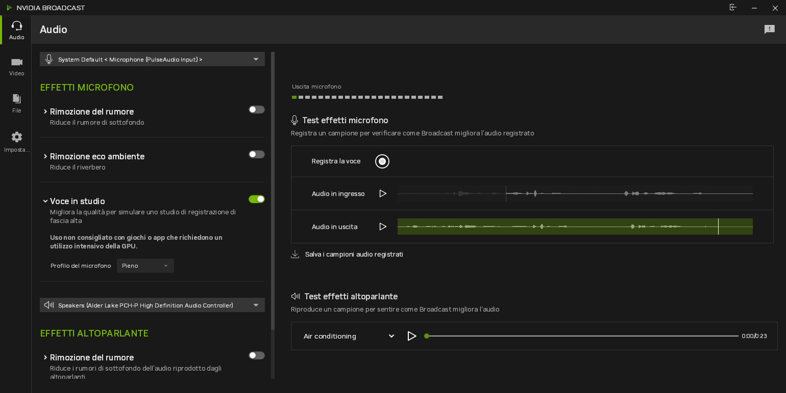

# NVIDIA Broadcast su Linux

[English](README.md)

Questo progetto esegue il vero NVIDIA Broadcast 2.3.0 per Windows su Linux tramite Wine (GE-Proton), con i modelli AI
originali di NVIDIA. Le applicazioni Linux vedono il risultato come microfono, altoparlante e webcam.



## Cosa funziona

| Funzione | Stato |
|---|---|
| Effetti microfono: rimozione del rumore, eco della stanza, Voce in studio | Funziona. Appare come sorgente PipeWire "NVIDIA Broadcast". |
| Effetti altoparlante: rimozione del rumore dell'audio in ingresso | Funziona. Appare come sink PipeWire "NVIDIA Broadcast". |
| Effetti camera: sfocatura o sostituzione dello sfondo, contatto visivo, inquadratura automatica | Funziona. Appare come webcam "NVIDIA Broadcast" (v4l2loopback). |
| Elaborazione file: WAV, e MP4 con video H.264 e audio AAC | Funziona, provata con file 720p e 1080p. Gli altri formati non sono stati provati. |

Altre immagini e qualche misura sono in [come si presenta](docs/it/demo.md).

## Prima di cominciare

- Servono una GPU NVIDIA RTX con driver proprietario e una tua copia dell'installer di NVIDIA Broadcast. Questo
  repository non contiene software NVIDIA e non è affiliato a NVIDIA.
- È stato sviluppato e provato su una sola macchina: Fedora 44 (kernel 7.2), KDE Wayland, PipeWire, una RTX 4060 Laptop
  GPU con driver 615.78.08, Secure Boot attivo. Su altri sistemi aspettati di dover adattare qualcosa.
- Il progetto è pensato per uso personale. Modifica un runner Wine e un prefix Wine sulla tua macchina e sostituisce
  alcune DLL user-mode di NVIDIA nel prefix con sostituti compatibili.

## Avvio rapido

```
git clone <questo repo> && cd broadcast-linux
scripts/build.sh
scripts/build-ffmpeg.sh        # solo se vuoi elaborare file video
scripts/setup-prefix.sh --installer ~/nvidia-files/broadcast-installer \
                        --nvngx-update ~/nvidia-files/driver/Display.Driver/nvngx_update.exe
scripts/deploy.sh
sudo scripts/setup-vcam.sh     # solo per la webcam
nvidia-broadcast
```

I due file NVIDIA nella riga di `setup-prefix.sh` vengono dai download di NVIDIA. La
[guida all'installazione](docs/it/install.md) elenca i pacchetti da installare prima e spiega come ottenere quei file.

## Documentazione

- [Installazione](docs/it/install.md): requisiti, file di NVIDIA, installazione, avvio.
- [Come si presenta](docs/it/demo.md): screenshot e misure.
- [Come funziona](docs/it/how-it-works.md): cosa non funzionava sotto Wine e come è stato risolto ogni pezzo.
- [Uso con OBS Studio](docs/it/obs.md)
- [Risoluzione dei problemi](docs/it/troubleshooting.md): cosa si rompe dopo gli aggiornamenti, dove sono i log, strumenti
  per sviluppatori.
- [Licenza e componenti di terzi](docs/it/licenses.md)

## Licenza

Il codice di questo repository è rilasciato con licenza MIT, vedi [LICENSE](LICENSE). FFmpeg, Wine e GE-Proton sono
sotto LGPL e non sono inclusi qui, vedi le [note sui componenti di terzi](docs/it/licenses.md).
