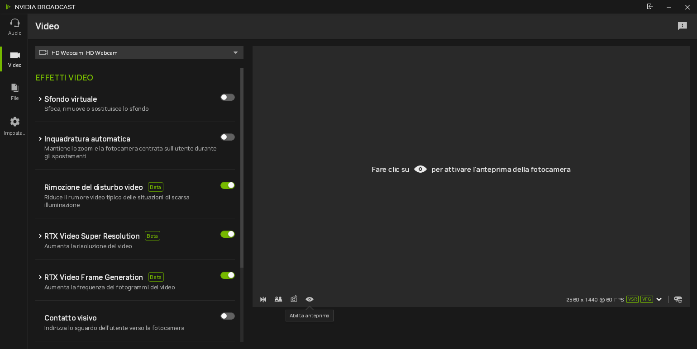
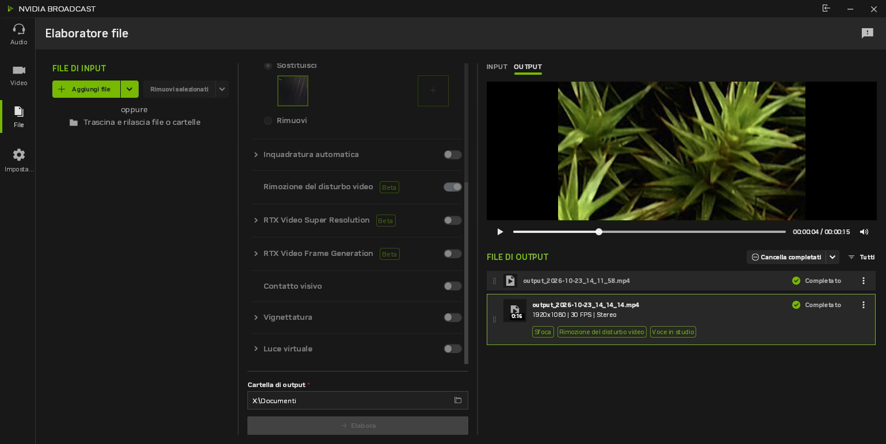
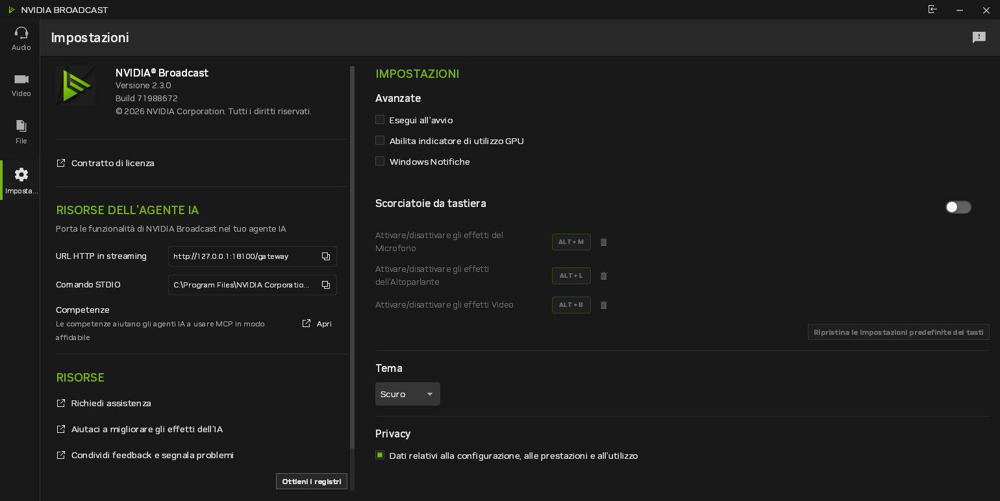

# What it looks like

[Italiano](it/demo.md) | [Back to the README](../README.md)

These are screenshots of the real NVIDIA Broadcast 2.3.0 running under Wine on Fedora 44 (KDE Wayland, RTX 4060 Laptop GPU).
The interface is in Italian because the system language is.

## Audio

Studio Voice is on for the microphone. The test panel on the right recorded a sample: the top waveform is the input and
the green one below is the processed output. The microphone appears to Linux applications as the PipeWire source
"NVIDIA Broadcast".

Running Studio Voice in real time used about 16 to 24% of the GPU (9 to 13% of memory bandwidth), around 1.1 GiB of VRAM
and 14 W, with the GPU at 57 °C. Video encoder and decoder stayed at 0%.

## Video

The Video tab lists the camera effects. The webcam is the input, and the processed picture is what applications see as the
webcam "NVIDIA Broadcast" (a v4l2loopback device).

## File processing

The Files tab processes audio and video files. This export ran on a 15 second, 1080p, 30 fps mp4 with background blur,
video noise removal and Studio Voice. The result is an mp4 with H.264 video and AAC audio. It had the same 467 frames
as the source and the full audio length, and it took 10 to 11 seconds on this GPU. A 5 second, 720p clip took under 3
seconds. WAV files work as well.

## Settings

The Settings tab confirms the version that runs: NVIDIA Broadcast 2.3.0.
